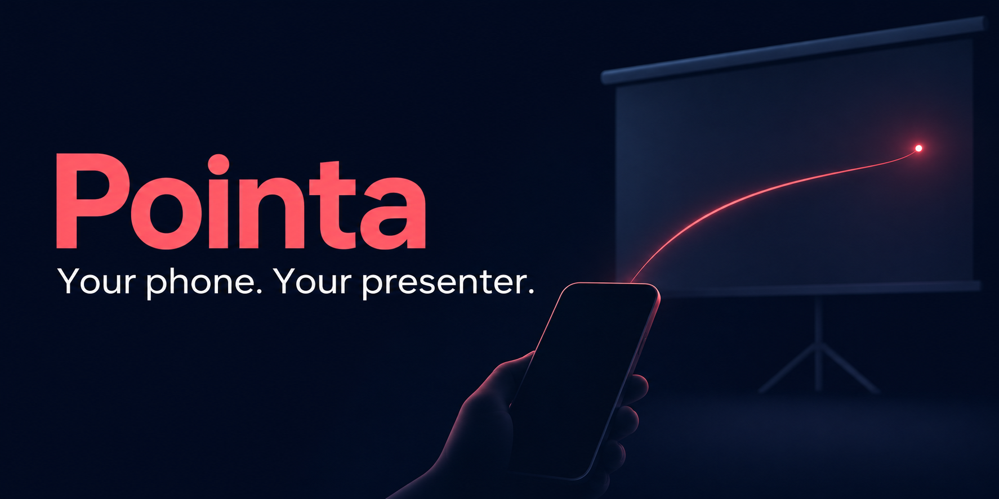
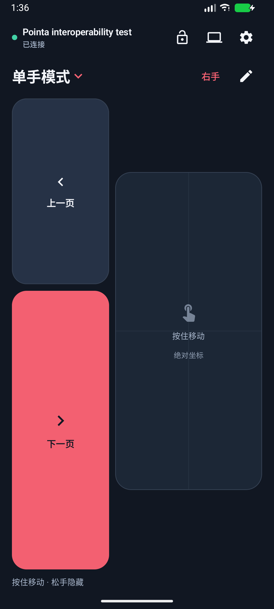
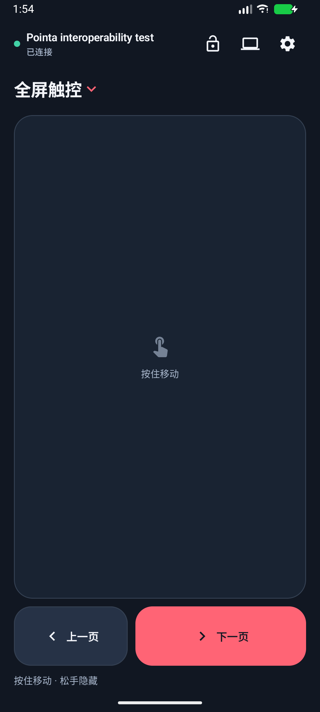
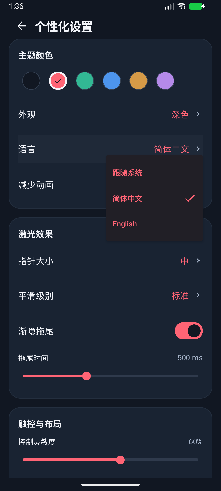

<h1 align="center">Pointa</h1>

Your phone. Your presenter.

<a href="README.md">简体中文</a> · <a href="https://github.com/zichen0116/pointa-android">Android companion</a> · <a href="LICENSE">MIT License</a>

Use an Android phone to change slides and move an independent laser pointer on a Windows screen. Pair over a reachable local network. No account or cloud relay required.

This is the **Windows app**. Install both the Windows receiver and the Android remote.

## Controls

- Full-screen touch: relative movement, with double-tap for the next slide.
- One-hand mode: absolute pointing and page buttons; resize the touch area in place, undo an adjustment or restore defaults.
- Air pointer: rotate the phone to point; no need to hold the screen. Recenter when needed.
- Slides only: two large buttons. Volume keys also work in the foreground control screen.
- A tapered laser trail follows the phone theme without moving the computer mouse.

  

Screenshots are captured from the running application in an isolated test environment. The banner is a brand illustration.

## Get started

**Preview: Windows 0.1.8 / Android 0.1.5. Release packages are pending acceptance testing.**

Get both apps from [Windows releases](https://github.com/zichen0116/pointa-windows/releases) and [Android releases](https://github.com/zichen0116/pointa-android/releases). Until packages are published, build from source or download artifacts from successful Actions runs (GitHub login required).

1. Connect the phone and computer to a mutually reachable LAN or a phone hotspot.
2. Scan the Windows QR code, or enter its IP address and six-digit code. Codes expire after three minutes.
3. Approve the first pairing on the computer, then focus your presentation application.

Android 8+ and Windows 11 x64 are the primary targets. Windows 10 compatibility, additional sensor models and multi-monitor setups need further testing. Preview APKs use a development signing key; Windows packages are not code-signed.

## Connection and compatibility

The same Wi-Fi name does not guarantee device-to-device access: guest and campus networks may isolate clients. Manual IP entry cannot bypass isolation. Add the app's local-subnet firewall rule when needed; do not disable the system firewall.

Focus PowerPoint, WPS, a supported browser or PDF reader before paging. An application-only screen share may omit the laser overlay; test sharing the full display. Pointa is not remote desktop software and cannot click or drag the system mouse.

## Contribute

See [development notes](docs/development.md), [architecture](docs/architecture.md), [validation](docs/validation.md) and [contribution guidelines](CONTRIBUTING.md). Bug reports from real presentation setups are welcome. Do not post credentials or pairing QR codes.

Inspired by [lan-laser-pen](https://github.com/fuxing0910-hue/lan-laser-pen); see [reference alignment](docs/reference-alignment.md). Licensed under [MIT](LICENSE); third-party notices remain in place.
