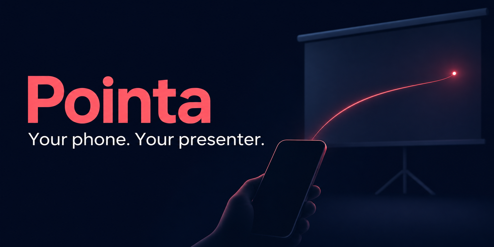
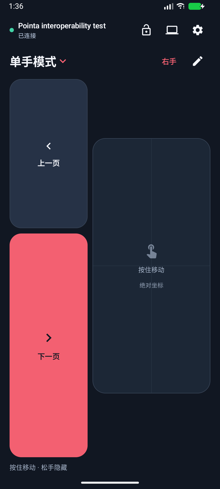
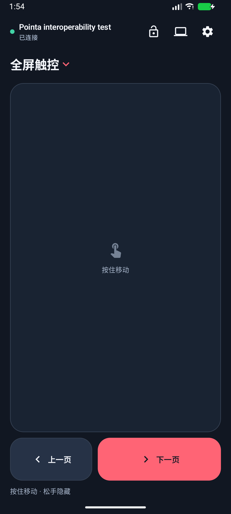
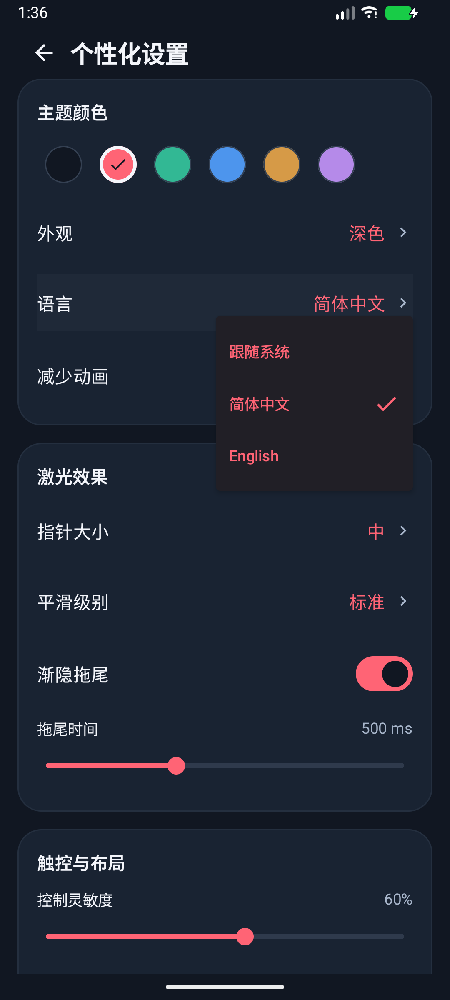
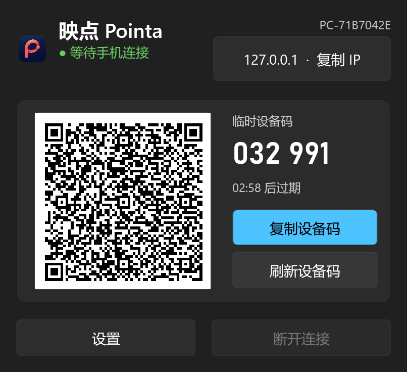

<p align="center"></p>
<h1 align="center">映点 Pointa</h1>
<p align="center">把手机变成翻页笔。</p>
<p align="center"><a href="README.en.md">English</a> · <a href="#开始使用">开始使用</a> · <a href="https://github.com/zichen0116/pointa-android">Android 端</a> · <a href="https://github.com/zichen0116/pointa-windows/issues">反馈问题</a></p>
<p align="center"><a href="LICENSE"></a>   </p>



讲课、答辩、做分享时，不用一直站在电脑旁。手机和电脑连到同一个可互访的局域网，扫码配对，就能翻页、移动激光光点。

这里是 **Windows 接收端**。手机负责操作，Windows 负责显示光点和执行翻页，两端需要配合使用。

## 演示时怎么用

- **全屏触控**：像触控板一样移动光点，双击触控区翻到下一页。
- **单手模式**：翻页键和触控区放在一起。直接拖动边缘调整大小，自动保存，支持撤销和重置。
- **空中指针**：进入模式后轻转手机指示，无需一直按住屏幕；偏了可以归零校准。
- **纯翻页**：只留上一页、下一页两个大按钮。也可以使用手机音量键。
- **激光拖尾**：收尖曲线随移动渐隐，颜色跟随手机主题。光点独立于系统鼠标，不抢电脑焦点。

不需要注册账号，不经过云端中转。首次配对需要电脑确认，以后从最近电脑手动连接。

## 看看界面

<table><tr><td align="center"><br>单手控制</td><td align="center"><br>全屏触控</td><td align="center"><br>主题与设置</td></tr></table>

<p align="center"></p>

以上为程序实际运行截图，来自隔离测试环境；横幅是品牌插画。没有把概念图当成功能截图。

## 开始使用

**当前为预览版：Windows 0.1.7 / Android 0.1.5。正式安装包将在本轮验收后发布。**

| 需要安装 | 获取方式 |
| --- | --- |
| Windows 接收端 | [发行页面](https://github.com/zichen0116/pointa-windows/releases) · [开发构建](https://github.com/zichen0116/pointa-windows/actions/workflows/build.yml) |
| Android 遥控端 | [发行页面](https://github.com/zichen0116/pointa-android/releases) · [开发构建](https://github.com/zichen0116/pointa-android/actions/workflows/build.yml) |

发行页面暂时没有安装包时，可自行构建，或在成功的 Actions 运行页面下载 Artifacts（需要登录 GitHub）。开发 APK 使用测试签名；Windows 安装包尚未代码签名。

1. 在电脑和手机上分别安装并打开 Pointa。
2. 连接同一个可互访的 Wi-Fi。也支持电脑连接手机热点。
3. 手机点“连接设备”，扫描电脑二维码，在电脑上允许配对。也可以输入电脑 IP 和六位设备码，设备码三分钟有效。
4. 把演示软件切到前台，开始翻页和指示。

Android 要求 8.0 及以上。Windows 优先支持 Windows 11 x64；Windows 10 兼容性还需更多实测。空中指针的体验取决于手机传感器。

## 常见问题

**同一个 Wi-Fi，为什么连不上？**

访客网络、部分校园网会隔离设备。先核对电脑 IP；手动输入 IP 也不能绕过网络隔离。Windows 若阻止连接，可在应用设置中添加仅限本地子网的防火墙规则，无需关闭防火墙。若待机后出现设备互访失败，可尝试重连电脑 Wi-Fi；本项目的环境排查记录见 [验证记录](docs/validation.md)。

**连接成功，但没有翻页？**

请把 PowerPoint、WPS、浏览器演示或 PDF 阅读器切到前台。Pointa 不会自动切换窗口。不同网页和阅读器对方向键的处理可能不同。

**会议共享时看不到激光？**

单独共享一个应用窗口可能不包含独立激光覆盖层，请测试整屏共享。HDR、独占全屏和多屏投影仍需按实际设备确认。

**这是鼠标遥控软件吗？**

不是。Pointa 控制演示翻页和独立激光，不移动系统鼠标，也不提供远程桌面、文件传输或鼠标点击。

## 开发与贡献

需要 .NET 10 SDK，在仓库根目录执行：

```powershell
./scripts/build.ps1
./scripts/test.ps1
./scripts/publish.ps1
```

自包含 ZIP 无需另外安装 .NET。生成 Setup 需安装 Inno Setup 6，再向 publish 脚本传入 `-Iscc`。

欢迎提交 [Issue](https://github.com/zichen0116/pointa-windows/issues) 和 PR。特别欢迎不同手机传感器、演示软件与网络环境的实测反馈；请附双端版本、复现步骤和错误原文，别上传配对二维码、凭据或私人演示内容。

[贡献指南](CONTRIBUTING.md) · [架构](docs/architecture.md) · [验证记录](docs/validation.md) · [更新记录](CHANGELOG.md) · [宣传素材](docs/media/README.md)

## 致谢与许可

受 [lan-laser-pen](https://github.com/fuxing0910-hue/lan-laser-pen) 启发，拖尾和姿态映射参考其网页实现；来源和对齐方法见 [说明](docs/reference-alignment.md)。感谢为实测、修复和文档付出时间的贡献者。

Pointa 使用 [MIT 许可证](LICENSE)。第三方组件保留各自的版权和许可。
