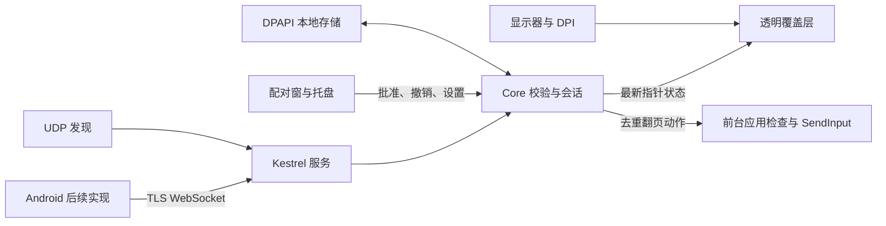

# 映点 Pointa：Windows 架构与实施决议

日期：2026-11-04。状态：实施基线，不代表功能已经完成或通过验收。

## 1. 产品边界与依据

Pointa 把 Android 手机变为演示用翻页笔。Windows 接收局域网指令，在独立透明覆盖层显示激光，并向当前允许的演示应用发送翻页按键。激光不移动系统鼠标，不点击远端窗口，不主动切换前台应用。

需求来源为 `docs/product/` 中的 PRD v1.0、UI 设计 V5、HTML 原型 V5。PRD 决定 P0 功能、安全与发布门槛；较新的 V5 决定品牌、视觉及已确认交互。HTML 中的二维码、设备码、连接、托盘和陀螺仪都是模拟，不能作为真实实现或验收证据。

本阶段先交付 Windows 可运行程序、测试与 Android 接入契约；Android 在 Windows 核心闭环验证后独立实施。没有 Android 真机、正式安装器或发布验证时，Windows 开发构建不称为成熟产品正式版。

V1 不加入云账号、公网中转、文件传输、通用鼠标遥控、屏幕视频传输、备注预览或完整绘图板。陀螺仪仍为 P1；纯翻页、音量键映射、单手布局编辑在后续 Android 阶段按 V5 保留。

## 2. 最小工程结构

使用 C# / .NET 10。一个桌面进程承载 WinForms UI、Kestrel 局域网服务和原生覆盖层，不要求用户运行终端或浏览器，也不额外安装后台系统服务。

| 工程边界 | 责任 | 不负责 |
|---|---|---|
| Core | 配置与可信设备模型、输入数据校验、短时配对状态、会话控制、去重与可测试的规则 | WinForms 控件、实际画屏、直接注入键盘 |
| Server | 使用 `Microsoft.AspNetCore.App` framework reference 的 Kestrel HTTPS/WSS、TLS 身份、配对传输、UDP 发现、连接生命周期 | UI 布局、绕过用户授权、直接移动系统鼠标 |
| Windows | WinForms 入口与单实例、配对窗、托盘、设置及授权、DPAPI 本地保护、显示器管理、原生激光覆盖层、受限翻页 | 公网服务、通用远程控制 |

这是责任边界，不是额外接口层要求。使用工程内实际公开类型连接现有模块，不为未来平台引入依赖注入容器、插件系统或消息总线。具体类名、消息字段、端口和密码学编码以实现及协议文档为准，不从本文件推导。

## 3. 线程、数据和生命周期

- WinForms 控件和覆盖层窗口由 UI 线程管理；网络及握手不阻塞 UI。后台事件需要回到 UI 线程时只提交小型状态更新，不执行同步网络等待。
- 高频移动采用最新有效状态优先，渲染读取最近坐标。不得为每个历史移动帧排一个必须执行的 UI 回调。坐标输入与显示平滑分开，限制平滑引入的延迟。
- 翻页是单独离散动作，经身份、状态、去重和前台应用检查后执行。失败反馈客户端，不能只靠手机按钮动画表示成功。
- 普通抬手隐藏活跃点，允许已有拖尾按时淡出；断线、撤销和紧急隐藏立即清除活跃内容。消尾结束后停绘，空闲时不以固定高帧率刷新透明整屏。
- 正常关闭配对窗只隐藏窗口。退出程序依次停止接受连接、关闭会话并隐藏覆盖层、关闭监听、释放托盘和图形资源。
- 已信任设备重连后从隐藏状态开始。睡眠、网络变化、显示器变化、凭据失效均需清理过期状态，不能回放此前的翻页或移动。

## 4. 网络与安全设计

### 4.1 网络边界

仅服务互相可达的本地网络。UDP 发现只提供定位线索，不能提供信任；设备名称、来源地址和发现结果均不当作身份认证。

默认只选择允许的私有网络接口，不在公共网络接口监听。实施时已观察到开发主机当前网络为 **Public**：默认界面应说明网络未启用，不自动改变 Windows 网络类别或静默放开全部网卡。设置可让用户明确选择启用当前网络，并说明这会让该网络内的设备访问配对服务；启用仍需 TLS、配对及 PC 授权。防火墙规则不得顺便开放公网或所有配置文件。

访客 Wi-Fi、校园/公司终端隔离可能导致同 Wi-Fi 不可互访。保留手动 IP 的协议路径及故障帮助，但 IP 输入无法绕过隔离。网卡移除或网络类别变化后，应重新评估监听范围。

### 4.2 首次配对与再次连接

1. Windows 维护持久的服务端 TLS 身份，并创建短时配对会话。默认六位设备码有效期为 120 秒，刷新和成功消费后旧会话失效。
2. QR 配对在扫描数据中携带一次性高熵令牌和服务端证书指纹。Android 用扫描所得指纹核验实际 TLS 对端，不要求安装 CA，也不提供全局忽略证书错误的客户端。
3. 数字码配对使用 Bouncy Castle SRP-6a 原语在现代 TLS 上完成口令认证。短码不通过网络直接发送，也不作为长期设备凭据。
4. 数字码流程必须认证绑定实际 TLS 对端证书，防止攻击者中继 SRP 后终止两段 TLS 并读取后续凭据。客户端使用其连接实际观测的证书，服务端使用本机证书；不能信任远端声称的指纹。绑定方式、序列化和向量由协议文档固定。
5. 双向证据验证成功后，PC 明确显示请求设备并允许/拒绝。只有批准且当前配对会话仍有效时，才签发独立随机长期凭据。所有失败路径关闭授权能力，错误信息与诊断不得泄露码、令牌或密钥。
6. 再次连接使用已保存的证书绑定和设备凭据。设备撤销后原凭据立即失效；证书发生变化不得静默重置信任，需要重新配对。

应用层 SRP 集成不等于 RFC 5054 的 TLS-SRP 密码套件，也不采用该旧规范列出的旧版 TLS/密码套件。Bouncy Castle 提供 SRP-6a 原语与双向证据 API，但整套应用协议、证书绑定、状态机和限流仍是本项目集成；**尚未经外部安全审计，不能宣称已满足 PRD 的安全评审发布条件**。标准组、公钥校验和测试向量应参考 [RFC 5054](https://www.rfc-editor.org/rfc/rfc5054) 及其[已核实勘误](https://www.rfc-editor.org/errata/rfc5054)，跨语言实现参考 [Bouncy Castle C# 源码](https://github.com/bcgit/bc-csharp/blob/master/crypto/src/crypto/agreement/srp/SRP6Client.cs) 和 [Java API](https://downloads.bouncycastle.org/java/docs/bcprov-jdk18on-javadoc/org/bouncycastle/crypto/agreement/srp/SRP6Client.html)。

### 4.3 凭据、消息与控制权

- Windows 私密持久化使用当前用户范围 DPAPI；普通外观设置与秘密分开处理。诊断仅输出脱敏状态，不复制密钥、完整令牌或配对码。
- TLS 私钥、长期凭据以及配对中的短码/验证数据应限制生命周期；短时配对状态不作为长期密码库保存。
- 同时仅允许一个活跃控制端。新请求不能静默抢走已有演示的控制权。
- 消息校验覆盖协议版本、类型、长度、字段范围、有限数字、序列及频率；未配对/未批准/已撤销连接不进入输入处理。
- 指针移动丢弃旧状态；翻页必须去重并拒绝过期动作；隐藏指令不能被积压拖延。具体阈值和错误码由协议文档定义。
- 对配对尝试与握手计算设置全局及来源限制，不能只依赖六位码的短效性。并发批准必须保证一次性令牌只消费一次。

## 5. Windows UI 与原生集成

### 5.1 主窗与托盘

V5 主窗以 100% 缩放下 365×410 为参考，自适应实际 DPI。内容自上而下为品牌标题栏、连接状态、二维码/设备码并排区域、覆盖层状态卡、网络及刷新底栏。关闭按钮表示收起托盘，不表示退出服务。

| 视觉项 | 基准 |
|---|---|
| 窗口 | 白色；边框 `#E4EAF2`；圆角参考 16 px |
| 品牌点 | `#F87581`，10 px |
| 正文 / 设备码 | `#243145` / `#243349` |
| 已就绪状态点 | `#39C49B`，7 px；错误不能沿用正常状态 |
| 主内容内边距 | 垂直 17、水平 19 px |
| 二维码 | 参考 143×143，左右配对区域间距 17 px；以真实扫描验证为准 |
| 设备码 | 参考 29 px，显示三位分组，复制不含空格的六位码 |
| 状态卡 | `#F5F8FB`，内边距 13、上间距 18 px |
| 卡片至底栏 | 约 26 px，避免恢复成 V4 的大留白 |

原生字体、触控/键盘目标和高 DPI 可访问性优先于逐像素照搬浏览器。真实二维码保留静区，不能继续使用原型格子图；若实际数据密度无法可靠扫描，需要调整二维码可用尺寸。

通过主窗补足设备名称、有效期、授权请求、当前手机及断开状态，通过托盘/设置提供设备管理、显示器选择、紧急隐藏、自启、语言及网络许可。授权拒绝、公共网络未启用、监听失败、配对过期和设备断线均显示可执行的下一步，不把失败包装成「等待连接」。

### 5.2 激光和翻页

覆盖层采用 WinForms/Win32 layered window 与逐像素 Alpha，使用透明穿透、无激活及工具窗口语义，避免进入 Alt+Tab。按选中屏幕物理边界映射归一化坐标，兼容虚拟桌面负坐标；显示器移除时安全回退主屏并通知。

默认红色光点、柔光和 500 ms 拖尾。V5 的主题色仅影响手机 UI；黑色主题不能改变激光颜色。拖尾设置采用 100–1200 ms、步长 50 ms、默认 500 ms；开关独立保存，关闭后保留之前时长。

翻页只对当前前台且允许的演示应用调用 `SendInput`。配对/设置窗在前台时不执行翻页，不为弥补焦点问题自动把某个窗口提到前台。浏览器进程在允许列表中不等于当前网页已处于演示，必须记录兼容限制；不能承诺任意浏览器页面都安全识别为演示。

分层窗口、焦点行为及输入限制参考 [Microsoft 窗口特性](https://learn.microsoft.com/en-us/windows/win32/winmsg/window-features) 和 [SendInput](https://learn.microsoft.com/en-us/windows/win32/api/winuser/nf-winuser-sendinput)。独占全屏、HDR、提升权限程序和单应用共享另做实测，不声称覆盖层在所有捕获方式中可见。

## 6. 阶段计划与发布门槛

| 阶段 | 可交付结果 | 离开阶段的证据 |
|---|---|---|
| W0：Windows 结构与核心 | 三层工程、托盘/小窗、覆盖层、受限翻页、核心测试 | 构建与自动测试通过；本机真实覆盖层不动鼠标、不抢焦点 |
| W1：Windows 连接闭环 | TLS、QR/数字码配对、PC 授权、单连接、撤销、设置、发现与诊断 | 测试客户端贯通配对—控制—断线—重连；负面安全用例通过；协议文档可供 Android 实现 |
| W2：Windows 开发分发 | 自包含程序、安装/卸载路径、基础兼容与资源记录 | 干净环境启动；记录安装、DPI、多屏、Public 默认关闭及休眠恢复测试，未完成项公开 |
| A0/A1：Android 独立阶段 | Kotlin/Compose、真实扫码与码配对、单手/全屏/纯翻页、持久化与重连 | C#/Java 配对向量相同，两端真机闭环；V5 交互和可访问性检查通过 |
| R1：联合发布候选 | Windows Setup.exe + Android APK | [验收矩阵](acceptance.md)全部发布必需项有证据；安全集成审查、两类 Android/Windows 设备、兼容/性能、许可和签名策略完成 |

开发版允许明确标识尚未通过真机及安全审查；不以「能够编译」替代普通用户可安装、可信配对和现场可靠性。具体 Android 依赖见 [交接清单](android-handoff.md)，许可来源见 [许可证记录](licenses.md)。
