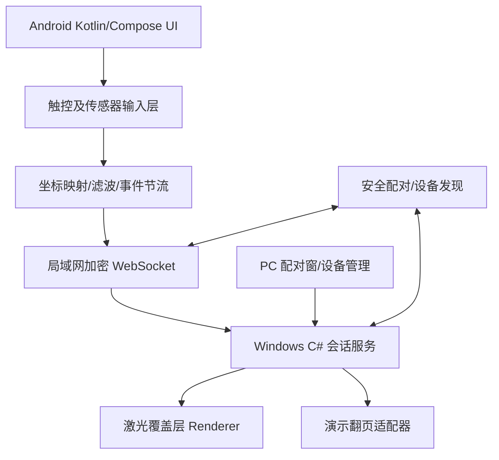
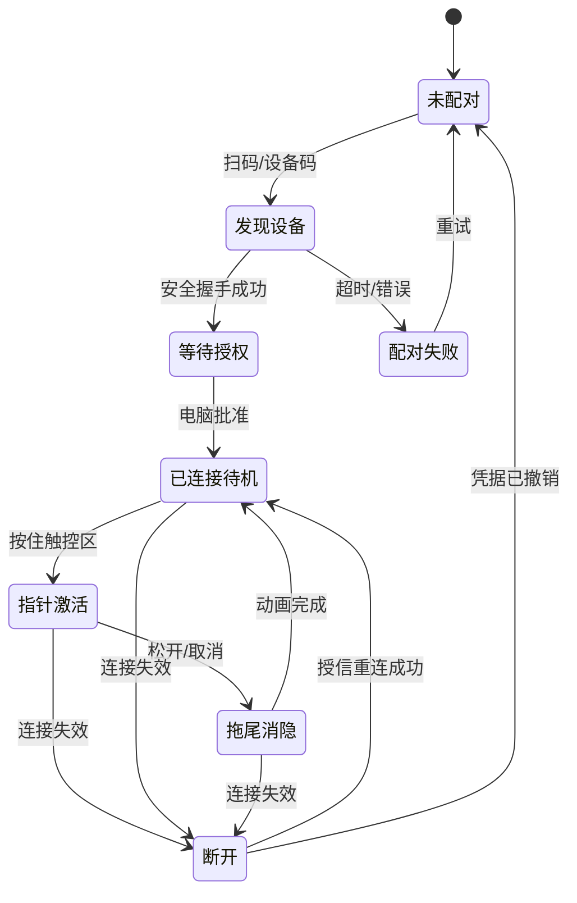

# 手机演示激光笔 — 产品需求文档（PRD）

> 文档版本：v1.0 Draft  
> 编写日期：2026-10-26  
> 产品名称：暂定「手机演示激光笔」，正式名称及图标待定  
> 首发平台：Windows 桌面端 + Android 手机端  
> 核心技术：C# / .NET 10 LTS / WinForms + Kotlin / Jetpack Compose  
> 目标：可拆解为开发任务、交互原型、验收测试的首版产品需求

---

## 0. 产品共识（必须贯穿设计）

1. **演示场景优先。** 面向 PPT、WPS 演示、Canva 演示、浏览器演示及 PDF 放映，聚焦「指示、强调、翻页」。
2. **激光独立于系统鼠标。** 光点在 Windows 透明置顶、鼠标穿透的覆盖层绘制；移动光点不会同步移动系统鼠标，不自动触发点击，也不抢占当前演示窗口的焦点。
3. **降低上手门槛。** Windows 安装/运行后展示二维码和设备码；Android 扫码或输入设备码即可配对；已配对设备方便重连。
4. **移动端体验优先。** 界面现代、整洁、中文友好；触控与拖尾顺滑；单手模式、全屏模式、左右手偏好、自定义均有明确设计。
5. **Windows 端小巧常驻。** 以托盘为核心，少弹窗、低 CPU、低常驻内存，不依赖启动命令、Node.js、Python 或浏览器。
6. **离线局域网优先。** 使用时不要求云账号、外部服务或互联网；通信加密、配对可信、权限最小化。
7. **优先打磨高频动作。** 低延迟、断线恢复、防误触及会议现场可靠性优先于堆积功能。
8. **模块化便于未来扩展。** 后续可添加 Web/PWA、小程序、iOS、演讲备注和进阶视觉特效，但首版不为这些方向承担过度复杂度。

### 0.1 一句话定位

> 拿起手机，扫码或输入设备码，即可在不打扰电脑鼠标的情况下，用流畅的数字激光与快捷翻页完成演示。

### 0.2 与参考项目的关系

| 项目 | 主要借鉴 | 明确需要改进之处 | 代码使用原则 |
|---|---|---|---|
| [lan-laser-pen](https://github.com/fuxing0910-hue/lan-laser-pen) | 演示专用定位、独立覆盖层、触控映射、约 500ms 拖尾、焦点保持 | Web/证书配置较繁琐、桌面运行链路较分散 | MIT；复用代码保留版权及许可 |
| [RemotePointer Android](https://github.com/schorschii/RemotePointer-Android) / [Server](https://github.com/schorschii/RemotePointer-Server) | PC 小窗、系统托盘、移动端与 PC 协同、配对交互 | 演示模式专注度、中文本地化、UI、指示手感 | GPL-3.0；参考思路，避免直接混入计划采用其他许可证的代码 |
| [gInk](https://github.com/geovens/gInk) / [ppInk](https://github.com/pubpub-zz/ppInk) | Windows 标注层、Win32 绘图、兼容性经验 | 功能复杂度不适合全部引入 V1 | 使用前逐一核验实际许可证及依赖 |

**竞争定位：** 不追求成为通用远程鼠标；核心评价指标是演示过程中的低干扰、操作便利、视觉品质和可靠性。RemotePointer 本身也支持数字激光，差异化需要由实际体验测试证明。

---

## 1. 用户与场景

### 1.1 目标用户

- **高校学生和科研人员**：课堂汇报、答辩、项目路演、组会。
- **教师和培训讲师**：教室投影、屏幕讲解、板书式强调。
- **企业职员/演讲者**：会议室、产品展示、远程屏幕共享与现场宣讲。

### 1.2 典型使用流程

**首次使用**

1. Windows 安装并运行程序，默认收进托盘，主动打开配对小窗。
2. 窗口展示设备名称、二维码与临时设备码。
3. Android 首次启动展示「扫码连接」「输入设备码」两个同级入口。
4. 手机完成配对，PC 明确授权陌生设备；配对成功后进入「演示遥控」主界面。
5. 用户切回 PowerPoint / Canva / WPS 等演示窗口开始使用。
6. 手机触摸控制独立激光光点，点击大按钮翻页，光点不挪动系统鼠标。

**日常重复使用**

1. Windows 服务已在托盘运行。
2. Android 启动后看到最近电脑，尝试在受信任的局域网中自动重连。
3. 成功后直接进入上次使用的交互模式；失败则提示扫码/设备码重新连接。

**演示现场异常**

- 无法发现设备：提示检查局域网、Windows 防火墙或访客 Wi-Fi 隔离，允许手动输入 IP + 设备码；推荐切换到 Windows 热点。
- 手机断线：Windows 光点立即安全隐藏，APP 显示断线状态并尝试重连；禁止重放旧的移动指令/翻页命令。
- 演示软件失去焦点：翻页提示失败可能原因，不静默切换到未知窗口、不意外修改其他软件。

---

## 2. 范围与优先级

优先级说明：**P0 = V1.0 发布必须完成；P1 = V1.1 优化；P2 = 远期探索**。

| 主题 | P0 — V1.0 | P1 — V1.1 | P2 — 后续 |
|---|---|---|---|
| Windows 部署 | EXE 安装/卸载、托盘常驻、小型配对窗 | 便携版、静默更新 | 多操作系统 |
| Android | 原生 APP、中文/英文、设备列表 | 更多主题与配置同步 | iOS / Web / 小程序 |
| 配对连接 | QR、设备码、自动重连、断线提示 | 多设备快速切换、热点引导 | 蓝牙/USB 传输 |
| 指示操作 | 独立激光、拖尾、触控、页面翻页 | 空中指针、聚光灯、指示动画 | 画笔、放大镜、标注保存 |
| 交互模式 | 演示单手模式、全屏触控模式 | 更丰富的布局编辑 | 自定义动作编排 |
| 兼容性 | 多屏选择、1080p/4K/DPI、主流演示应用验证 | 应用识别及快捷键配置 | 演讲备注/幻灯片预览 |
| 安全 | 本地加密配对、可撤销、受限连接 | 更多设备管理设置 | 企业管控 |

**明确排除于 V1.0：** 系统鼠标全功能遥控、点击/拖动远端窗口、文件传输、云账号、远程公网连接、实时桌面画面传输、实时 PPT 缩略图/备注、语音控制、多人同时控制、完整绘图板。

---

## 3. Android 端详细功能需求

### 3.1 IA：信息架构与页面

```text
启动 / 启动画面
 ├── 首次引导（仅首次，可跳过）
 ├── 设备连接页
 │    ├── 最近设备列表（在线、离线、连接中）
 │    ├── 扫描二维码
 │    ├── 输入设备码
 │    └── 连接故障帮助 / 输入局域网 IP
 ├── 演示遥控主界面（默认）
 │    ├── 演示单手模式（默认）
 │    ├── 全屏触控模式
 │    ├── 模式切换 / 连接状态 / 紧急隐藏
 │    └── 激光视觉效果入口
 └── 设置
      ├── 显示与语言
      ├── 左手 / 右手、按钮与触觉反馈
      ├── 指针颜色、大小、光晕、拖尾时长
      ├── 触摸灵敏度与坐标映射
      ├── 设备管理、移除信任设备
      └── 关于、开源许可、反馈
```

### 3.2 F-AND-01：扫码配对（P0）

- 首次进入连接页展示突出的大型「扫描二维码」入口。
- 扫码后完成主机发现、安全握手、设备授权和保存可信设备。
- 连接中提示当前阶段：连接电脑 / 等待确认 / 已连接。
- 失败给出可操作原因与重试入口；没有相机权限时仍可使用设备码。
- 成功后主动切换遥控页面，并通过短振动确认。

**验收：** 相同可达局域网且双方授权的情况下，完成扫码后无需安装证书或手动输入 IP 即可进入遥控界面。

### 3.3 F-AND-02：设备码配对（P0）

- PC 显示一个临时、一次性数字码，建议首版为 **6 位**、有效期 **120 秒**（可在技术评审中调整）。
- APP 提供 6 格数字输入、大键盘、自粘贴/自动聚焦、错误提示、重新获取码。
- **设备码只承担临时配对用途，不作为长期设备密码**。
- 手机先在本地网络中发现可配对 PC；若发现失败，显示「输入 IP 地址」高级入口。**单纯输入设备码无法跨任意局域网定位主机**。
- 首次通过设备码配对需要可信握手及电脑端授权；成功后保存设备级凭据。
- 防暴力尝试：码到期失效、单次消费、错误次数限制、短暂冷却。

**验收：** 关闭相机权限仍可完成设备码配对；错误/过期码无法连接；陌生设备未授权不可控制 PC。

### 3.4 F-AND-03：最近设备与自动重连（P0）

- 最近设备展示用户自定义名称、在线状态、最近连接信息。
- APP 前台启动时，仅对已信任的最近设备尝试自动重连；支持关闭自动重连。
- 重连成功回到上次模式，但激光默认处于未激活状态。
- 连接失败不阻塞 UI；提供改用其他设备、扫码、设备码、IP 手动连接。
- 删除设备后本机移除凭据，PC 同步撤销配对；单方不可达时提示本地遗忘与远端撤销的区别。

### 3.5 F-AND-04：演示单手模式（P0，默认）

**目标：** 站立讲课时拇指能完成大部分常用动作。

- 画面重点集中于下半部：核心控制区、明显的「下一页」和较小的「上一页」按钮。
- 页面顶部只保留简洁的电脑名称/连接状态、模式切换、设置入口。
- **下一页**优先展示为更大的按钮；左手/右手模式通过镜像布局适配拇指位置。
- 激光区域使用**按住移动、松手隐藏并淡出拖尾**的语义，避免持续出现红点。
- 单手触控区默认使用**相对位移映射**，首次按下从上次光点位置继续移动，防止拇指放下瞬间大幅跳点。
- 两个翻页按钮触达范围至少满足 Android 触控建议（建议不小于 48dp）；操作有简短且可关闭的振动反馈。
- 翻页和指示控制互不遮挡，主界面无需切页操作即可完成基本演示。
- 支持锁定当前布局，防止误触进入设置。

**验收：** 单手可以连续完成「下一页 → 指示 → 松开 → 下一页」，无需切换功能页；激光动作不会造成系统鼠标移动或窗口失焦。

### 3.6 F-AND-05：全屏触控模式（P0）

- 提供近乎整屏的激光触控画布，适合精确指出幻灯片内容。
- 默认采取**绝对坐标映射**：触控面归一化到所选 Windows 显示器；与手指位置有直观对应关系。
- 可在设置里改为相对映射；覆盖层光点位置按显示器分辨率、横竖比、裁剪留白调整。
- 手指接触显示指针，滑动形成自然拖尾，抬手后光点/轨迹按设置渐隐。
- 全屏模式保留一条可收起的窄工具栏（返回、上/下一页、快速隐藏），避免复杂手势与画布冲突。
- 不使用单指边缘滑动作为默认翻页，以免破坏靠边缘指示内容的操作。

**验收：** 各屏幕角落可被准确指向，无坐标越界；退出/进入全屏后已配对连接保持稳定。

### 3.7 F-AND-06：激光拖尾与视觉自定义（P0）

Windows 覆盖层渲染，Android 控制参数。

- **默认效果**：红色实心指针 + 轻微光晕 + 平滑拖尾；默认轨迹淡出时间 **500ms**，参考 lan-laser-pen 的视觉手感。
- V1.0 可调整：颜色（预设色）、指针大小（小/中/大）、轨迹开关、拖尾时长（例如 0/250/500/800ms）、平滑级别（低/标准/高）。
- 保留真实原始采样点与显示插值算法的分离，限制滤波引起的额外滞后；快速移动时优先跟手。
- 隐藏状态下完全不绘制活跃光点；轨迹淡出结束后停止无意义重绘。
- 视觉效果设置实时下发 PC 并可持久化；恢复默认设置入口明确。

**验收：** 默认红点清晰可见，拖尾连续无明显断裂；连续快滑不会出现持续积压的旧位置；关闭轨迹后不保留光点残影。

### 3.8 F-AND-07：幻灯片翻页（P0）

- 默认映射：上一页 `Left Arrow`，下一页 `Right Arrow`。
- 按下后显示轻微按钮动画及可选振动，不虚构当前页码。
- 禁止长按误触引发无限翻页；V1 可采用单次按下触发并设置短冷却时间。
- 手机向 PC 发送明确动作类型 `slide.prev` / `slide.next`；与指针坐标消息分开。
- Windows 侧将按键送至已聚焦的演示应用；无法确定演示窗口时明确提示，不贸然操纵其他窗口。
- 不提供原生鼠标移动/点击控制作为默认功能。

### 3.9 F-AND-08：设备状态与反馈（P0）

- 顶部轻量状态：已连接 / 连接中 / 断开 / PC 未响应。
- 断线时激光控制禁用，保留返回连接页的入口，不让用户误认为已成功翻页。
- 可见的局域网连接状态提示；避免常驻闪烁提示、弹窗或频繁 Toast。
- 长时间演示保持屏幕常亮可由设置控制；APP 退到后台或屏幕关闭时默认停止激光输出。
- 相机权限仅在扫码时请求；没有传感器的手机仍能完整使用触控模式。

### 3.10 F-AND-09：语言与视觉规范（P0）

- 默认中文随系统语言，首发完整提供 **简体中文 + 英文**；可在设置中手动切换。
- **视觉关键词**：现代、克制、舒适、高对比、低学习成本，不采用复杂的仪表盘式堆砌布局。
- 基于 Compose 和 Material 3 组件体系设计，保留独立品牌色与设计 Tokens。
- 默认深色界面优先考虑演讲现场，提供浅色主题和跟随系统选项。
- 有清晰的主次信息层级，页面尽量少文字；高频按钮使用图标与简短文字。
- 支持不同手机宽高比、刘海/挖孔屏、安全区域，左右手切换不降低内容可见性。
- 控件触控区域原则上 ≥48dp，并支持无障碍描述、字体缩放和减少动画设置。
- 首次体验通过 2～3 张可跳过引导介绍连接、触控与翻页；避免教程遮挡正常使用。

### 3.11 F-AND-10：空中指针（P1）

- 使用 `SensorManager` 的适当旋转向量/陀螺仪数据，做相对旋转映射；支持手腕小幅移动来移动光点。
- 支持一键校准中心、灵敏度、反转方向、平滑/死区配置。
- 采取「按住激活，松手停止」或可选锁定激活，降低漂移和误触。
- 必须在不同安卓品牌真机上验证漂移、传感器速率和轴方向；不可将姿态角映射宣传为对屏幕真实空间位置的精确测量。
- 如需早期体验验证，可以在 V1 工程加入实验性隐藏入口；**正式 V1 验收不受此功能阻塞**。

---

## 4. Windows 端详细功能需求

### 4.1 F-WIN-01：安装、启动、托盘（P0）

- 提供面向普通用户的 `Setup.exe` 安装器，安装后从开始菜单运行；无需用户手动装 Node.js 或配置开发环境。
- 安装包与主程序可独立分发；优先提供自包含运行时版本，减少首次使用障碍。单独权衡安装包与运行内存。
- 支持系统托盘；关闭配对/设置小窗时程序继续在托盘运行。
- 托盘菜单包含：打开配对、显示/隐藏激光、设备管理、选择显示器、设置、退出。
- 系统启动时自动运行作为**可选设置，默认关闭**；自动启动时不弹出主窗口。
- 仅运行一个主实例，重复启动聚焦现有设置/配对窗口。
- 退出时关闭监听端口、释放覆盖层和系统资源，不留下残留服务进程。
- 卸载时停止后台运行，用户可选择清除已配对设备/配置。

### 4.2 F-WIN-02：轻量配对小窗（P0）

- 窗口体积精简，核心只显示设备名、连接状态、二维码、临时 6 位设备码。
- 展示网络地址/网络状态，但 IP 归入「高级信息」；支持刷新设备码、显示有效期。
- 支持「当前已连接手机」及断开/拒绝控制入口。
- 当新设备请求配对时，PC 显示设备昵称和明确的「允许/拒绝」授权提示。
- 窗口收起托盘后仍然能继续控制和响应已信任设备。
- 不要求为了配对打开网页或使用命令行。

### 4.3 F-WIN-03：独立透明激光覆盖层（P0，核心）

- 在选定显示器上绘制透明、置顶、逐像素 Alpha 的覆盖层，包含红点和淡出拖尾。
- 覆盖层必须支持**鼠标穿透、不抢焦点、不进入 Alt+Tab**；用户实际系统鼠标位置保持不变。
- V1.0 不注入通用鼠标移动事件；仅翻页命令在必要时模拟键盘按键。
- 覆盖层根据手机指令启动显示与隐藏；空闲时不连续无条件刷新。
- 用户可以一键紧急隐藏覆盖层；切换显示器时重新计算坐标变换。
- 与 Windows DPI、缩放和多屏虚拟桌面坐标体系正确协作。
- 对独占全屏、HDR、部分投影/视频软件、提升权限的程序及「只共享单个应用窗口」场景给出兼容性说明；不保证所有窗口截取方式可捕获覆盖层。

**实现方向：** C# WinForms 原生窗口 + P/Invoke `WS_EX_LAYERED` / `WS_EX_TRANSPARENT` / `WS_EX_NOACTIVATE` / `UpdateLayeredWindow` 等，按需优化 GDI+/Direct2D 绘制。

### 4.4 F-WIN-04：幻灯片控制与焦点保护（P0）

- 接收 `slide.next` / `slide.prev`，默认通过 `SendInput` 发送左右方向键。
- 覆盖层和后台网络事件不得主动激活其窗口，保护原演示软件的前台焦点。
- PC 配对窗获得焦点后，按键可能影响错误窗口：需要在产品层有提醒或检测机制；V1 首选要求用户将演示软件置前台，并限制向非演示应用注入键盘事件。
- 可维护可配置的简单演示程序白名单；失败时给出检查焦点的提示。
- V1 不强制与 PowerPoint COM / Canva Web API 绑定，保持跨应用兼容。

### 4.5 F-WIN-05：目标显示器选择（P0）

- 默认激光显示于用户选择的主显示器；多屏环境可在托盘小窗中切换目标屏幕。
- 在 Windows 缩放 100% / 125% / 150% 和屏幕热插拔时正确计算坐标。
- 保存上次使用显示器，找不到时回退到可用的主屏，并提示用户。
- 对 16:9、16:10、超宽屏和竖屏显示器，采取合理的映射策略与边界约束。

### 4.6 F-WIN-06：设备管理与安全（P0）

- 查看已授权手机及最近连接状态，能够单独踢出、撤销配对或清空全部授权。
- 未配对设备不能发送合法控制事件；可以限制同一时刻仅 **1 个活跃控制端**，防止多人干扰。
- 启用局域网监听时优先限定私有网络；公共网络或访客 Wi-Fi 提醒风险。
- 对连接请求、控制事件做长度/频率/类型校验；禁用任意命令执行能力。
- 显示基本连接信息与可复制的脱敏诊断内容，用于反馈和排错。

---

## 5. UI / UX 设计规范

### 5.1 Android 设计原则

1. 主界面一眼可以看到「设备连接状态」和「下一页」。
2. 高频操作在拇指热区，减少跨屏手势。
3. 大面积操作区优先响应手势，次要功能放入可收起工具栏。
4. 渐变、阴影、动效服务于状态反馈和识别；避免过量装饰。
5. 手机屏幕偏暗的教室/会议室中阅读舒适，对强光环境也有足够对比度。
6. 保持模式语义一致：放下手指显示激光、松开隐藏，按钮的触觉反馈可预测。
7. 设置项提供实时效果预览，默认值足够好，用户不需要调整才能顺手。

### 5.2 Android 首版页面草图（信息布局示意）

```text
┌────────────────────────────────┐
│ ● 已连接  我的笔记本      ⚙   │
│                                │
│          演示遥控              │
│                                │
│      ┌────────────────┐        │
│      │                │        │
│      │  单手激光区域   │        │
│      │  按住并滑动    │        │
│      │                │        │
│      └────────────────┘        │
│                                │
│    ┌────────┐ ┌────────────┐   │
│    │ 上一页 │ │  下一页 →  │   │
│    └────────┘ └────────────┘   │
│                                │
│   单手    全屏触控    更多      │
└────────────────────────────────┘
```

**说明：** 这是内容关系示意。最终组件比例、单手触控区位置、按钮尺寸和颜色在 Figma 或 Compose Prototype 阶段通过真机验证确定。

### 5.3 Windows 小窗草图（信息布局示意）

```text
┌─────────────────────────────┐
│ 手机演示激光笔          ─ × │
│                             │
│      [ 配对二维码 ]         │
│                             │
│    设备码：  4 8 2 6 1 3    │
│      有效期：01:32         │
│                             │
│  ● 等待连接 / 已连接 1 台   │
│                             │
│  设备管理       设置    ⌄   │
└─────────────────────────────┘

托盘：打开配对 / 显示或隐藏激光 / 显示器 / 设置 / 退出
```

### 5.4 动效与品牌（待视觉设计）

- UI 风格：现代极简、低密度视觉、原生流畅感。
- 暂不强行设定最终品牌色；激光红只是默认指针色，界面强调色可独立设计。
- 动画建议 120～220ms，主打快速的状态反馈；对延迟敏感的光点绘制禁用多余 UI 过渡。
- Android 图标、Windows 托盘图标保持统一的轮廓和识别度。
- 界面设计交付物建议包括：色板、字体层级、间距 Tokens、图标、按钮状态、连接状态、空状态、错误态、深浅主题、左右手布局。

---

## 6. 实时交互与协议要求

### 6.1 整体架构



### 6.2 首版消息模型（示例）

消息统一携带协议版本与序列号；示例仅定义产品协议方向，不构成最终安全握手标准。

```json
{"v":1,"type":"pointer.move","seq":301,"x":0.47,"y":0.62,"active":true,"ts":1761491400000}
```

```json
{"v":1,"type":"pointer.hide","seq":302,"ts":1761491400016}
```

```json
{"v":1,"type":"slide.next","id":"action-uuid","ts":1761491400030}
```

```json
{"v":1,"type":"effect.update","size":16,"color":"#EF4444","trailMs":500}
```

坐标字段使用归一化 `[0, 1]`，由 Windows 根据当前选定显示器处理映射。`pointer.move` 属于**最新状态优先**消息，允许丢弃过期帧；翻页属于离散动作，必须有去重 ID，重连后禁止重复执行。

### 6.3 连接与配对安全

- Windows 局域网服务通过 TLS 加密的 WebSocket 接入，默认不暴露公网。
- 扫码形式可携带局域网服务地址、一次性令牌、服务端公钥/证书指纹等必要信息，并通过 Android 端信任绑定来避免人工安装 CA。
- **设备码流程必须用经过审核的安全配对方案实现**：推荐 PAKE（如合适的 SPAKE2+ 实现）或经安全评审的等效设计；不采用简单将 6 位数字直接作为永久鉴权密钥的方案。
- 首次配对经用户在 Windows 界面确认，新设备获得独立凭据；撤销后不能复用旧凭据。
- 设备发现建议优先 mDNS，必要时加入局域网广播探测；发现失败可以手动输入 IP + 配对码。
- 对失败尝试进行节流，避免弱码被暴力测试。
- 防重放、单连接控制权、消息校验、断线后指针安全隐藏均应覆盖。

### 6.4 网络约束

- 手机与电脑处于互相可访问的局域网；两端同连 Wi-Fi 并不一定保证可互访，企业网络、酒店访客 Wi-Fi 可能开启终端隔离。
- 不要求互联网；不提供云中转功能。
- Android 发现局域网设备时需考虑平台权限、Wi-Fi 组播接收限制及设备厂商差异。
- 同一个会话中仅允许一个活动控制端；切换控制权时明确提示。

### 6.5 渲染与输入解耦

- 手机采样、网络推送、Windows 指针更新和图形渲染采用分层设计。
- 渲染以**最近有效坐标**为准，并在呈现层实现有限的平滑与尾迹生命周期。
- `pointer.hide` 与断线事件必须拥有高优先级，不能因为历史队列积压而出现延迟隐藏。
- 可单独调节触控灵敏度、平滑级别和拖尾时长，不互相混淆。

---

## 7. 非功能要求（NFR）与测量方法

以下数字为**研发目标**，必须在测试设备上实测，不代表现在已达到。

| ID | 项目 | V1.0 目标 | 测试方式 |
|---|---|---|---|
| NFR-01 | Windows 空闲 CPU | 稳态接近 0%，目标平均 <1% | 任务管理器 / 性能计数器，空闲 10 分钟 |
| NFR-02 | Windows 空闲私有工作集 | 以 ≤80 MiB 为首版优化目标 | 明确统计主进程及相关子进程；1080p 单屏 |
| NFR-03 | 触控到光点可见延迟 | 同一良好局域网下 P95 <100ms，冲刺 <60ms | 高帧率同步录像，100 次以上采样 |
| NFR-04 | 触控跟随平滑度 | 常规 60Hz 显示器上无明显连续跳帧、拖尾突变 | 快速/慢速/折返触控实测 |
| NFR-05 | 断线安全 | 连接失效后及时隐藏激光；不执行过期翻页指令 | 强制断网、杀进程、切换 Wi-Fi |
| NFR-06 | 重连 | 局域网恢复后自动重连；目标 5s 内恢复大部分普通场景 | 断网恢复 30 轮；统计 P50/P95 |
| NFR-07 | 兼容 | Windows 11 x64 优先，Windows 10 x64 尽力兼容；Android 8.0+ 作为初定下限 | 系统/机型矩阵测试；Windows 10 已结束常规支持 |
| NFR-08 | Android 流畅度 | 目标 60fps 的主界面交互；高频输入不触发全页不必要重组 | Android Profiler / FrameTiming |
| NFR-09 | 网络负担 | 输入数据尽量轻，坐标按需节流；不传输屏幕视频流 | Wireshark/Profiler 的吞吐统计 |
| NFR-10 | 本地化 | 首发用户可见主要文案 100% 简体中文/英文覆盖 | 文案清单与伪本地化检查 |
| NFR-11 | 隐私 | 无账号、无演示内容采集、无默认遥测上传 | 代码审查、网络流量抓包 |
| NFR-12 | 恢复能力 | App 或 PC 配对窗退出/重开可恢复安全状态；不残留异常覆盖层 | 异常关闭与系统睡眠恢复测试 |

**关于包体与内存：** .NET 10 自包含部署更容易做到安装即用，安装包可能明显大于原生 Rust/C++ 单文件程序。首版不预设一个可能不现实的「几 MB EXE」指标；以真实安装器体积、内存和用户无需额外配置这三项综合评估。1080p 的单张 BGRA 全屏缓冲区约 7.9 MiB，4K 约 31.6 MiB，双缓冲和多个显示器会显著增加占用。

---

## 8. 工程实现与仓库组织建议

### 8.1 技术栈决议

**Windows**

- C# + .NET 10 LTS + WinForms。
- Windows 透明置顶绘制使用 Win32 P/Invoke；起步可参考 lan-laser-pen 的 C# 覆盖层思路。
- 局域网服务使用 C# WebSocket 技术栈；服务和覆盖层尽量运行在单一进程内。
- 基于托盘通知图标 + 极简 WinForms 窗口；无须浏览器引擎。
- 安装器可选择 Inno Setup / WiX / MSIX 等，按签名、升级和部署需求选型。

**Android**

- Kotlin + Jetpack Compose + Material 3。
- CameraX + 可靠二维码解码库；Android SDK `SensorManager` 为后续姿态功能保留接口。
- 输入、状态、设备持久化与 UI 分层，避免传感器/高频坐标流直达 Compose 大范围重组。
- 基于 Kotlin Coroutines/Flow 管理连接状态、输入事件与界面状态；安全存储设备凭据。

### 8.2 模块边界

```text
presentation-laser/
├── README.md
├── docs/
│   ├── PRD.md                 # 本需求文档
│   ├── protocol.md            # 消息与配对规范
│   ├── ux-flows.md            # 交互流程和状态机
│   ├── benchmarks.md          # 内存 / CPU / 延迟基准
│   └── licenses.md            # 开源复用与版权声明
├── windows/
│   ├── App/                   # WinForms 主程序 / 托盘 / 设置
│   ├── Pairing/               # 设备发现、扫码、设备码认证
│   ├── Transport/             # WSS、会话、消息校验
│   ├── Overlay/               # 透明激光窗口 / 绘制 / 拖尾
│   ├── Presentation/          # 键盘翻页及目标应用识别
│   ├── Settings/              # 持久化配置和设备信任
│   └── Installer/
├── android/
│   └── app/
│       ├── ui/                # Compose 页面 / 组件 / 主题
│       ├── pairing/           # 扫码 / 设备码 / 设备发现
│       ├── connection/        # WebSocket / 自动重连
│       ├── controller/        # 触控模式 / 坐标采样 / 翻页
│       ├── sensors/           # 姿态控制，后续启用
│       └── settings/          # 本地配置 / 语言 / 设备
└── tests/
    ├── protocol/
    ├── compatibility/
    └── performance/
```

### 8.3 实现建议

- 服务端承担坐标呈现、信任管理、输入事件映射；手机端承担交互、采样和轻量数据处理。
- 首版使用简单版本化 JSON 协议，优先可调试；确实发现瓶颈后才评估二进制协议。
- 控制端与绘制端功能分离，避免通过手机的通用系统鼠标模拟来实现光点。
- 兼容性问题先通过小型实测 Demo 验证：屏幕叠加层、光点跟手、Windows 焦点保护、局域网发现、手机扫码。

---

## 9. 关键交互状态机



**补充约束：** 翻页是一个独立、瞬时、幂等保护的离散控制事件，不改变指针激活状态。正常重连时指针必须先保持隐藏，等待用户下一次触摸激活。

---

## 10. 验收用例（最小闭环）

| 编号 | 用例 | 预期结果 |
|---|---|---|
| TC-01 | Windows 全新系统安装运行 | 出现配对窗/托盘，无需命令行及第三方运行时手工配置 |
| TC-02 | Android 扫描 PC 二维码 | PC 授权后完成连接并进入演示主界面 |
| TC-03 | Android 禁用相机，用设备码连接 | 经局域网发现或 IP 手动输入完成安全配对 |
| TC-04 | 演示程序前台播放时滑动手机触控区 | 独立激光点跟随，系统鼠标原地不动，焦点保持 |
| TC-05 | 手机停止触控 | 光点消隐，拖尾按设置时长淡出，渲染进入低负载状态 |
| TC-06 | 连续点击下一页、上一页 | 当前前台演示程序按期望切换，单次动作不被重复执行 |
| TC-07 | 右手布局切换左手布局 | 主要触控区和按钮布局适配，设备连接不中断 |
| TC-08 | 切换全屏触控 | 光点准确映射至目标显示器，能从角落覆盖至角落 |
| TC-09 | Windows 多屏 + 高 DPI | 坐标无明显偏移，能选择投影屏幕，热插拔有回退 |
| TC-10 | 关闭 Windows 配对窗口 | 服务留在托盘；手机依然能控制 |
| TC-11 | 网络中断再恢复 | 不保留不安全的活跃光点；自动重连；旧翻页不重放 |
| TC-12 | PC 撤销已配对手机 | 手机不能继续发送控制命令，需要重新配对 |
| TC-13 | 浏览器演示 Canva | 投影目标上可以看到独立激光；翻页取决于前台网页对方向键的支持 |
| TC-14 | 共享整个屏幕与只共享应用窗口 | 明确记录差异与限制，不虚构所有捕获模式均可见激光 |
| TC-15 | 中英文切换及深浅主题 | 核心功能文案完整、布局无溢出、页面可继续使用 |
| TC-16 | 异常关机、强退、再启动 | 不残留覆盖层或失控监听服务 |

---

## 11. 发布路线与开发里程碑

### M0 — 技术可行性样机

- Windows 托盘小窗、透明激光覆盖层、鼠标穿透、翻页。
- Android 触控控制 + 基本 WSS 连接。
- 对比同一手机控制 lan-laser-pen/RemotePointer 时的主观手感；录制高帧率延迟视频进行基准。

**门槛：** 演示窗口不失焦；移动光点不动系统鼠标；跟手且没有严重卡顿。

### M1 — 连接与体验闭环

- 二维码与设备码配对、设备管理、授权、安全信任。
- Android 单手模式、全屏模式、默认激光拖尾。
- Windows 安装器、托盘运行、双语基础设置。

**门槛：** 普通用户无需开发环境，可在局域网中完成安装—配对—演示。

### M2 — 可靠性与发布

- 多显示器、DPI、设备重连、应用前台控制、错误诊断。
- 视觉细节、性能分析、权限审计、许可清单和安装包签名策略。
- 至少两类 Android 真机 + 两类 Windows 配置进行端到端测试。

**门槛：** 通过第 10 节全部 P0 用例，发布测试版 APK + Windows Setup.exe。

### M3 — V1.1 迭代

- 空中指针与校准、聚光灯、更多主题/可配置项。
- 根据真实用户行为与反馈进一步打磨单手手势、视觉动画和错误引导。

> 交付时间依赖熟悉程度、设备数量和安全配对实现复杂度。建议以以上验收门槛控制版本，不强设无法验证的交付日期。

---

## 12. 风险与产品决策记录

| 风险 | 影响 | 处理策略 |
|---|---|---|
| 企业/学校 Wi-Fi 终端隔离 | 扫码和设备码均无法直连 | 明确故障引导；IP 手动模式；未来考虑热点辅助 |
| 拖尾平滑增加延迟 | 手感变差 | 滤波与轨迹效果独立；记录 P95 触控到显示延迟 |
| Windows 覆盖层兼容性 | 全屏/录屏时光点不出现 | 优先测试主要演示软件与整屏共享；明确限制 |
| 翻页影响错误窗口 | 误操作风险 | 保持演示焦点、应用判断、必要时提示用户回到演示软件 |
| 6 位设备码安全 | 可能被扫描/猜测 | 一次性短效、节流、可信握手、PC 端授权 |
| .NET 自包含体积较大 | 安装包不够小 | 对比 Framework-dependent 与 Self-contained，权衡一次安装体验 |
| Android 多厂商差异 | 触控、扫码/传感器表现不一致 | 先覆盖常见设备；触控模式不依赖传感器 |
| 复用 GPL 开源代码 | 分发许可证义务 | 参考设计时保持代码来源清晰，优先合法复用 MIT 内容 |

### 12.1 已定事项

- Windows：C# + WinForms；Android：Kotlin + Jetpack Compose。
- 核心目标：演示激光覆盖层，不直接操作鼠标。
- 必备交互：单手模式、全屏触控、红色拖尾、上一页/下一页。
- 必备连接：二维码、设备码、设备记忆/自动重连。
- Windows 托盘、小配对窗口、低资源占用。
- 中文优先、英文支持、手机端自定义外观与交互。
- 未来考虑小程序/浏览器端，但不加入 V1 范围。

### 12.2 待确认（已有默认方案，当前不阻塞开发）

1. **正式产品名称和 Logo：** 先用工作名「手机演示激光笔」，品牌视觉在 M1 前确定。
2. **空中陀螺仪功能是否首发：** 默认 P1，在 M0 完成可行性验证后可上调优先级。
3. **演示模式中的默认指针映射：** 单手相对映射；全屏绝对映射，允许用户设置切换。
4. **激光轨迹风格：** 默认红点 + 柔光 + 约 500ms 拖尾，后续基于真机体验微调。
5. **演示应用支持列表：** 先重点测试 PowerPoint、WPS、Canva 浏览器演示、常见 PDF 阅读器和基于浏览器的幻灯片。
6. **开发版分发：** 先提供 Windows x64 安装包 + Android APK；正式上架平台、自动更新与代码签名策略在 M2 决定。
7. **开源许可：** 在实际复用第三方源码并确认各依赖许可后再确定正式项目 LICENSE。

---

## 13. V1.0 的成功标准

用真实场景衡量，而非单纯统计功能数：

- **首次连接容易：** 用户可以在没有开发知识的情况下完成 Windows 安装与 Android 配对。
- **核心操作自然：** 不看教程，也能在短时间内理解单手翻页和触控激光。
- **不会打断汇报：** 激光独立于 Windows 鼠标，覆盖层鼠标穿透；不会意外夺取演示程序焦点。
- **视觉体验令人满意：** 红点跟手、拖尾自然、没有明显输入滞后。
- **可以信赖：** 断线、切屏、投影、休眠唤醒等常见操作能恢复；遇到限制会正确提示。
- **资源使用克制：** Windows 后台长期驻留不明显消耗 CPU 与内存；数据有可复现的测量结果。

---

## 14. 参考资料

- LAN Laser Pen：https://github.com/fuxing0910-hue/lan-laser-pen
- RemotePointer Android：https://github.com/schorschii/RemotePointer-Android
- RemotePointer Server：https://github.com/schorschii/RemotePointer-Server
- gInk：https://github.com/geovens/gInk
- ppInk：https://github.com/pubpub-zz/ppInk
- Microsoft layered windows：https://learn.microsoft.com/en-us/windows/win32/winmsg/window-features
- Microsoft .NET support：https://dotnet.microsoft.com/en-us/platform/support/policy
- Android Jetpack Compose：https://developer.android.com/compose
- Android game rotation vector：https://developer.android.com/reference/android/hardware/SensorEvent

> 本文是产品需求文档，不是最终技术实施规范。通信安全协议、应用焦点限制、实际性能和各类设备兼容性需通过 M0 样机、代码评审和真机验收确认。
